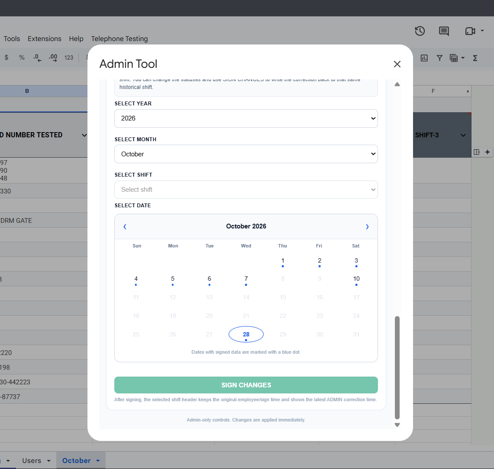
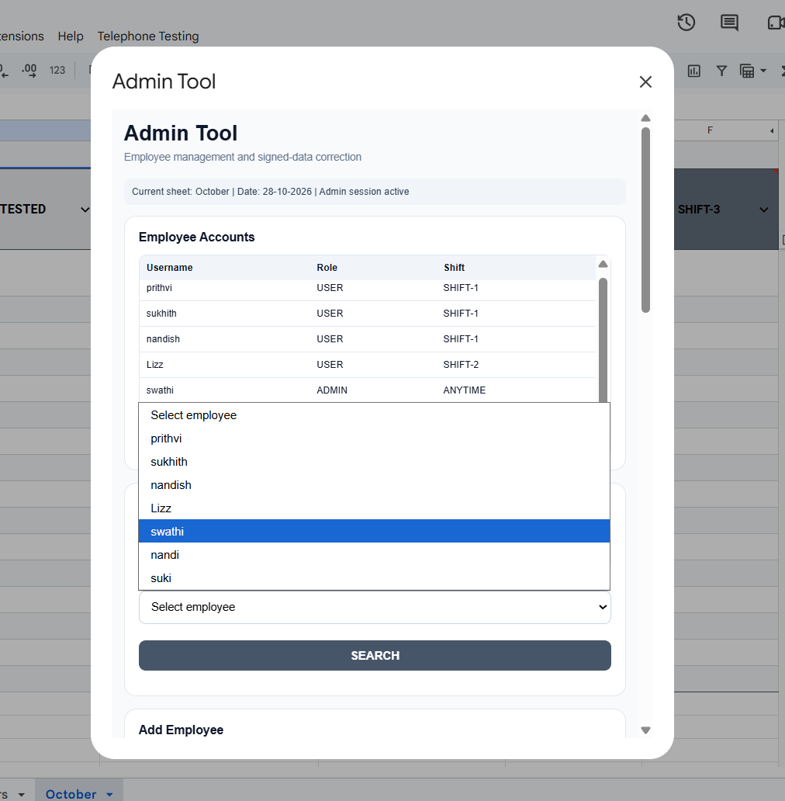
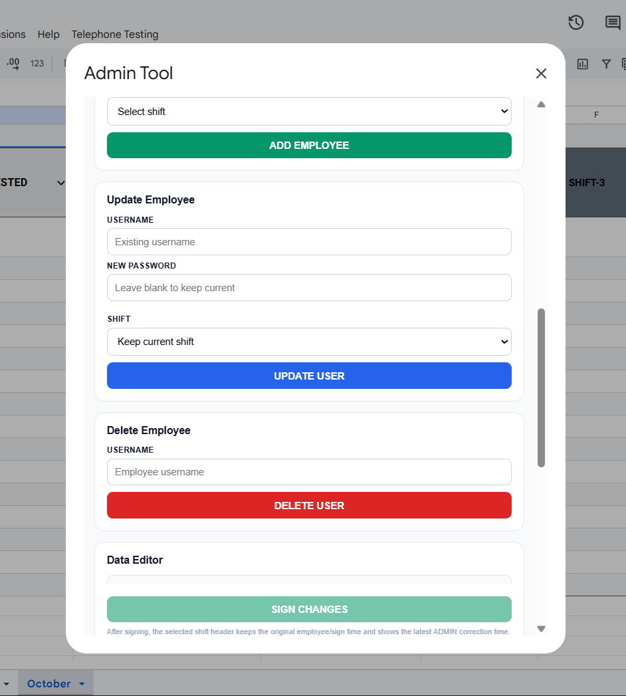
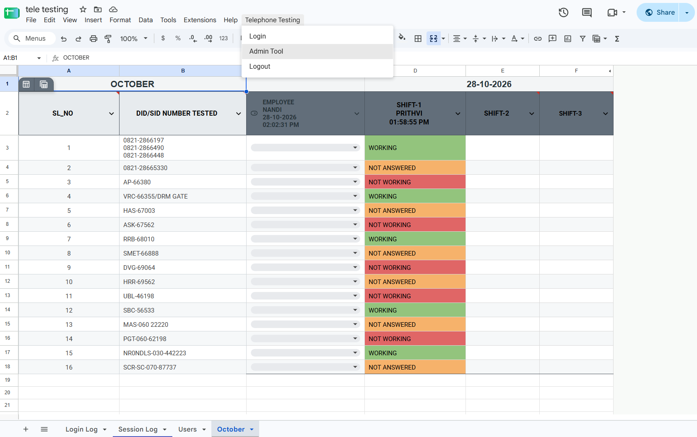
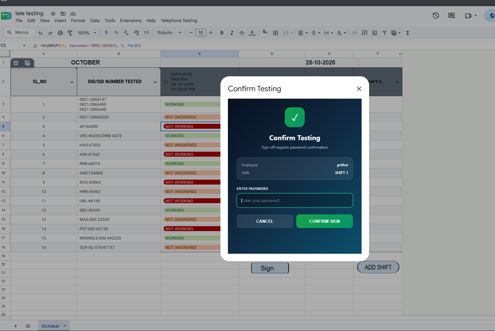
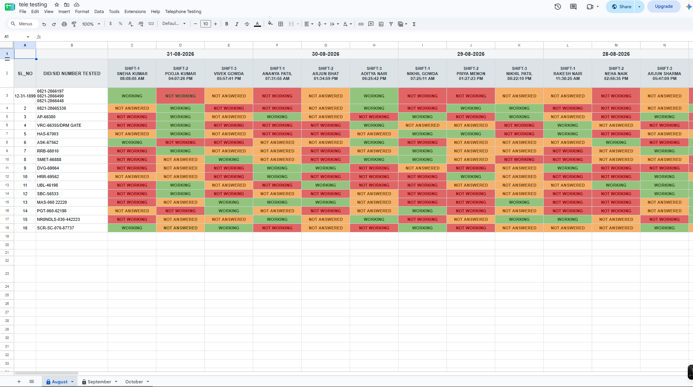
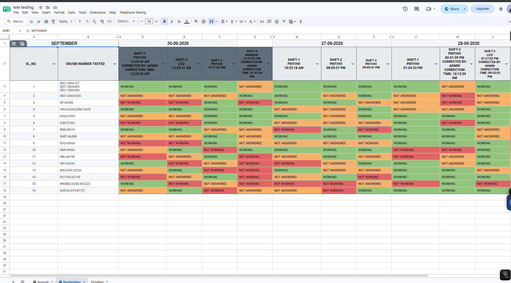
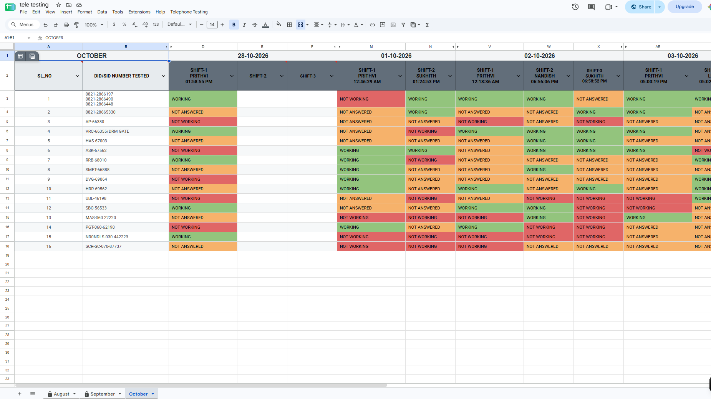
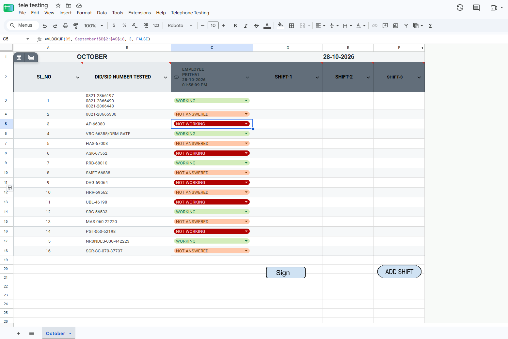
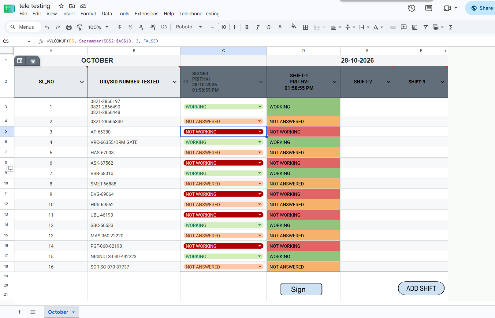

<div align="center">

# Railway Testing Log Automation

### A Google Sheets + Google Apps Script workflow for organized testing records

<p>
  
  
  
  
</p>

**A portfolio case study in spreadsheet workflow automation, record organization, and administrative tooling.**

</div>

---

## Project at a glance

This project automates parts of a railway testing-log workflow built around Google Sheets and Google Apps Script. It was designed to make recurring record-keeping tasks more consistent, organize records across reporting periods, and provide a dedicated interface for permitted administrative updates.

## The challenge

Maintaining a recurring operational log can involve repetitive daily preparation, organizing entries by month and shift, preserving historical records, and managing corrections without giving every user the same editing access.

The project brings these tasks into a single spreadsheet-based workflow, with Apps Script handling automation and an HTML-based administrative interface supporting authorized maintenance.

## What it includes

| Capability | Purpose |
|---|---|
| **Daily rollover and archiving** | Supports the transition from one day's working log to the next while retaining historical entries. |
| **Month-wise organization** | Keeps records arranged in reporting-period-specific sheets. |
| **Historical-sheet protection** | Helps restrict edits to past reporting periods according to configured access rules. |
| **Sign-in / sign-out workflow** | Supports employee sign-in and sign-out record keeping. |
| **Shift management** | Organizes workflow information around shifts. |
| **Admin Tool / Data Editor** | Provides a dedicated interface for permitted administrative corrections. |
| **Role-aware workflow** | Separates ordinary user interactions from administrative operations. |

*Feature descriptions should be checked against the final delivered version before public release. Access restrictions should not be described as a security guarantee unless they are enforced and verified in the server-side logic.*

## Screenshots

The screenshots below illustrate the workflow. Confirm that each image uses synthetic/demo data or is approved for public release before publishing the repository.

### 01 — Administrative calendar view

<p align="center">
  
</p>

### 02 — Admin interface and available features

<table>
  <tr>
    <td width="50%" align="center">
      <strong>Admin interface</strong><br><br>
      
    </td>
    <td width="50%" align="center">
      <strong>Admin features</strong><br><br>
      
    </td>
  </tr>
  <tr>
    <td width="50%" align="center">
      <strong>Admin tool</strong><br><br>
      
    </td>
    <td width="50%" align="center">
      <strong>Sign-in proof view</strong><br><br>
      
    </td>
  </tr>
</table>

### 03 — Monthly record organization

<table>
  <tr>
    <td width="33%" align="center">
      <strong>August</strong><br><br>
      
    </td>
    <td width="33%" align="center">
      <strong>September</strong><br><br>
      
    </td>
    <td width="33%" align="center">
      <strong>October</strong><br><br>
      
    </td>
  </tr>
</table>

### 04 — Employee sign-in flow

<table>
  <tr>
    <td width="50%" align="center">
      <strong>Before sign-in</strong><br><br>
      
    </td>
    <td width="50%" align="center">
      <strong>After sign-in</strong><br><br>
      
    </td>
  </tr>
</table>

---

In Admin Tool here is how Calendar section works 
https://github.com/user-attachments/assets/d83f89b1-0dd3-401b-928d-096b5a16ec4e

## How the workflow fits together

```text
                  ┌─────────────────────────┐
                  │          User           │
                  └────────────┬────────────┘
                               │
                               ▼
                  ┌─────────────────────────┐
                  │      Google Sheets      │
                  │  Log and monthly views  │
                  └────────────┬────────────┘
                               │
                               ▼
                  ┌─────────────────────────┐
                  │   Google Apps Script    │
                  │ Daily/monthly workflows │
                  │ Shift and sign-in logic│
                  │ Access-related rules    │
                  └────────────┬────────────┘
                               │
                               ▼
                  ┌─────────────────────────┐
                  │   HTML Admin Tool       │
                  │ Permitted maintenance   │
                  │ and data corrections    │
                  └─────────────────────────┘
```

This is a high-level conceptual diagram, not a deployment or security diagram. The exact implementation may vary by version.

## Technology

| Technology | Role in the project |
|---|---|
| **Google Sheets** | Spreadsheet interface and record organization |
| **Google Apps Script** | Automation and workflow logic |
| **JavaScript** | Script implementation |
| **HTML** | Administrative interface |

## Repository layout

```text
railway-log-automation/
├── assets/
│   ├── August-sheet.png
│   ├── admin-features.png
│   ├── admin-interface.png
│   ├── admin-tool.png
│   ├── aftre-signing-employe.png
│   ├── before-employe-sign.png
│   ├── calender-view-admin.png
│   ├── october-sheet.png
│   ├── proof-of-sign.png
│   └── september-sheet.png
├── demo/
│   └── sample-data.csv
├── docs/
│   ├── architecture.md
│   └── showcase.md
├── .gitignore
├── PUBLICATION_CHECKLIST.md
└── README.md
```

The repository also contains a profile image named `build-bengaluru-prithvi-hn.png`. It is intentionally not displayed in this project README; use it only if you want a personal attribution section and are comfortable publishing it.

## Demo and setup status

**Current repository type: documentation and portfolio showcase.**

The repository structure shown here does not include the Apps Script source files needed to deploy the full automation. The screenshots and documentation explain the project; they do not make this repository independently runnable.

A separate runnable demo could be prepared by:
1. Creating a new Google Sheet with entirely synthetic data.
2. Adding only code that you have permission to publish.
3. Removing client identifiers, live spreadsheet IDs, deployment URLs, account details, and credentials.
4. Testing the demo with a non-production account.
5. Documenting setup, permissions, and known limitations.

## Project outcome

The workflow was designed to reduce repetitive spreadsheet administration, improve daily and monthly record organization, and provide a clearer path for authorized corrections. Add measured results only if you have evidence to support them.


<div align="center">

**Built as a practical automation project using Google Sheets and Google Apps Script.**

<sub>Portfolio case study · Sanitized showcase · Client details intentionally omitted</sub>

</div>
